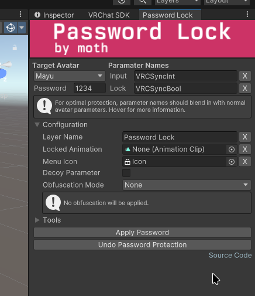
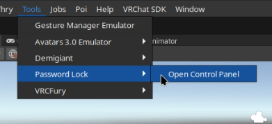

# VRC Password Lock
Modern password lock for VRChat avatars.  

## Features
- Drop in replacement for the (now deprecated) [GabSith VRC Password Lock](https://gabsith.gumroad.com/l/Password)
  - In the tools tab, use the button titled "Remove GabSith Lock"
- Decoy parameter to make force-unlocking more difficult
- Obfuscation to hide the password from avatar rippers
- Lock animation
- Custom parameter and layer names
- Non-destructive (does not modify your original assets)
- Works with projects that contain multiple avatars

## Usage
1. Add this package to VCC / ALCOM using [the website](https://peri-perihelion.github.io/VRC-PasswordLock/)
2. Open the Password Lock Control Panel from the Tools tab in Unity 
 
3. Change the settings as you see fit, and hit "Apply Password".
4. Any time you wish to modify the avatar, press "Undo Password Protection" first.
   - If this ever fails, simply set your layers back to their original assets. 
     The script never modifies them, so there's no way to lock yourself out of your own avatar.
